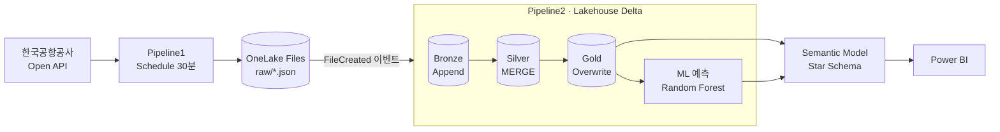

# fabric-airport-congestion-ml-forecast

**Microsoft Fabric 기반 공항 혼잡도 분석과 ML(Random Forest) 30분 후 예측 (개인 프로젝트)**

| | |
|---|---|
| 기간 | 2026.07 |
| 구분 | 개인 프로젝트 |
| 데이터 | 한국공항공사 공항 혼잡도 Open API (공공데이터포털) |
| 스택 | Microsoft Fabric (Lakehouse, OneLake, Data Pipeline, OneLake Event Trigger), Notebook (PySpark), Delta Lake, Spark ML, Power BI (Semantic Model, DAX) |

## 무엇을 만들었나

공항 혼잡도 공공 API 를 30분마다 쌓아, **공항·시간대별 혼잡 현황**과 **30분 후 예측**을 한 화면에서 보는 Fabric 분석 플랫폼.

| 문제 | 방법 |
|---|---|
| API 는 호출할 때마다 그 시점의 혼잡도를 준다. 모아 두지 않으면 추이를 볼 수 없다 | 30분 주기 수집, 응답 원본을 Raw JSON · Bronze 에 계속 누적 |
| 같은 공항·같은 시각이 다시 수집되면 중복 집계된다 | Silver 를 공항 + 시각 키로 MERGE (신규 INSERT, 기존 UPDATE) |
| 현재 값만으로는 곧 붐빌지 알 수 없다 | Random Forest 회귀로 30분 후 전체 혼잡도를 예측해 실제값과 비교 |

대시보드가 답하는 질문: 지금 어느 공항이 가장 붐비나 / 하루 중 몇 시가 가장 붐비나 / 체크인·신분확인·보안검색 중 어디가 붐비나 / 30분 후 혼잡도는 어떨까

## 아키텍처



## 문서

| 문서 | 내용 |
|---|---|
| [docs/pipeline_trigger.md](docs/pipeline_trigger.md) | 순차 파이프라인 → 이벤트 기반으로 바꾼 구조, Pipeline1/2, Trigger 설정 |
| [docs/data_model.md](docs/data_model.md) | 계층별 저장 전략(Append / MERGE / Overwrite), Silver 정제, Gold, Star Schema |
| [docs/ml.md](docs/ml.md) | 예측 모델 사양, 모델 선택, 개선 과제 |
| [powerbi/dax_measures.md](powerbi/dax_measures.md) | DAX 측정값 |

## 코드 포함 범위

작업 기록에 코드가 남아 있는 부분만 올렸다. 나머지 단계는 문서로 설명한다.

| 단계 | 저장소 |
|---|---|
| API → Bronze (이벤트 트리거 이전 버전) | [`notebooks/01_api_to_bronze.py`](notebooks/01_api_to_bronze.py) |
| Pipeline1: API → Raw JSON 저장 | 문서만 |
| Raw JSON → Bronze (`source_file` 추가) | 문서만 |
| Bronze → Silver (표준화, MERGE) | 문서만 |
| Gold Fact, `dim_date`, `dim_airport` | 문서만 |
| Gold 요약 (공항별, 시간대별) | [`notebooks/04_gold_summary.py`](notebooks/04_gold_summary.py) |
| ML (Random Forest) | [`notebooks/05_ml_random_forest.py`](notebooks/05_ml_random_forest.py) |
| DAX | [`powerbi/dax_measures.md`](powerbi/dax_measures.md) |

- 노트북 코드는 Fabric 노트북 세션(`spark`, `display`)에서 실행되며, 이 저장소에서 단독 실행하지 않는다.
- API 서비스 키는 코드에 두지 않는다 (`.env.example`).

## 상태

| 항목 | 상태 |
|---|---|
| 30분 주기 수집, FileCreated 트리거, Bronze/Silver/Gold, 예측, 대시보드 | Fabric 에서 구현·실행 |
| 예측 성능 수치 | 기록 없음 |
| 시간 기준 평가 분할, 회귀 오차 지표 | 개선 과제 ([docs/ml.md](docs/ml.md)) |

## 구조

```
notebooks/   Fabric 노트북 코드 (기록에 남아 있는 부분)
powerbi/     DAX 측정값
docs/        파이프라인·트리거, 데이터 모델, ML
```
